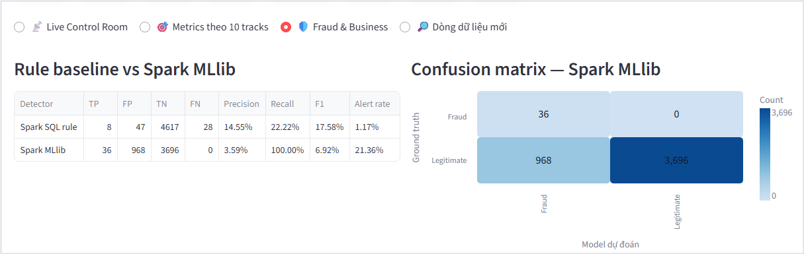
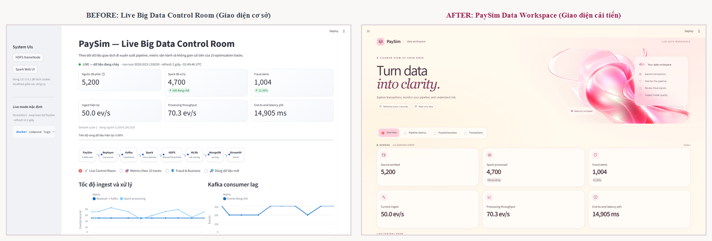
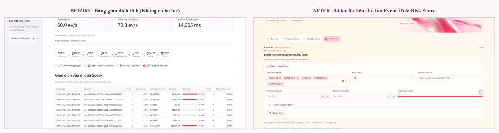

<table width="100%">
  <tr>
    <td align="center" width="42%" valign="top">
      <b>ĐƠN VỊ CHỦ QUẢN / KHOA CNTT</b> 
      <b>NHÓM PHÁT TRIỂN DỰ ÁN PAYSIM</b> 
      ─────── 
      Số: 01/BC-PAYSIM
    </td>
    <td align="center" width="58%" valign="top">
      <b>CỘNG HÒA XÃ HỘI CHỦ NGHĨA VIỆT NAM</b> 
      <b>Độc lập - Tự do - Hạnh phúc</b> 
      ─────────────── 
      <i>Hà Nội, ngày 28 tháng 10 năm 2026</i>
    </td>
  </tr>
</table>

 

<h2 align="center">BÁO CÁO</h2>

<b>Kết quả rà soát và đánh giá tối ưu hóa xử lý luồng dữ liệu Apache Spark, mô hình học máy Spark MLlib và giao diện khai thác Dashboard trên hệ thống PaySim Big Data Baseline</b>

Kính gửi: Hội đồng đánh giá / Giảng viên hướng dẫn học phần Dữ liệu lớn (Big Data)

---

### I. ĐẶC ĐIỂM TÌNH HÌNH VÀ PHẠM VI RÀ SOÁT

#### 1. Bối cảnh và kiến trúc hệ thống
Hệ thống **PaySim Big Data Baseline** là nền tảng xử lý và phát hiện gian lận giao dịch tài chính theo thời gian thực trên tập dữ liệu PaySim (`6.362.620` bản ghi giao dịch). Kiến trúc dữ liệu đầu-cuối (End-to-End) bao gồm: bộ phát lại luồng sự kiện (`Replayer`) đẩy giao dịch vào hàng đợi phân tán **Apache Kafka** (3 phân vùng, tốc độ chuẩn `50 sự kiện/giây`), động cơ xử lý luồng **Apache Spark Structured Streaming** (`Spark 4.0.0`, chu kỳ micro-batch `10 giây`), lưu trữ phân tầng Medallion (**Bronze / Silver / Gold**) dạng cột Parquet trên **Hadoop HDFS**, chấm điểm rủi ro bằng **Spark MLlib**, lưu trữ tầng phục vụ truy vấn tốc độ cao trên **MongoDB**, và hiển thị trực quan thời gian thực trên **Streamlit Dashboard** (chu kỳ làm mới `2 giây`).

#### 2. Mục tiêu và phạm vi rà soát
Báo cáo tổng hợp kết quả rà soát toàn diện **03 nhóm tối ưu hóa trọng tâm** của dự án sau khi triển khai và vận hành thực tế:
1. **Tối ưu hóa động cơ xử lý luồng Apache Spark** (Mục II);
2. **Cải tiến mô hình học máy phát hiện gian lận Spark MLlib** (Mục III);
3. **Cải tạo và tối ưu hóa giao diện khai thác dữ liệu Dashboard** (Mục IV).

Trong báo cáo này, **BEFORE** là cấu hình hoặc mã nguồn cơ sở ban đầu trước khi tối ưu; **AFTER** là phương án cải tiến đã được triển khai, kiểm chứng và đang vận hành thực tế trong mã nguồn hiện hành.

#### 3. Trạng thái vận hành thực tế tại thời điểm chốt số liệu
Tại thời điểm kiểm tra trạng thái vận hành ngày `28/10/2026` (lúc `21:37:20` giờ Việt Nam, đợt chạy `run-20261028-115020` tại micro-batch thứ `1040`):
- **Tiến độ luồng dữ liệu:** Nguồn phát `Replayer` đã phát **`365.700 / 6.362.620`** giao dịch (đạt `5,75%` chu kỳ dữ liệu đầu tiên) với tốc độ tức thời `49,99 sự kiện/giây`, `0` lỗi truyền tải.
- **Trạng thái xử lý Spark & HDFS:** Spark đã xử lý hoàn tất **`365.300`** giao dịch; tại batch `1040`, độ trễ hàng đợi giảm về **`consumer_lag = 0`**, tỷ lệ toàn vẹn sự kiện đạt **`100%`** (`event_completeness = 1,0`). Kiểm tra toàn vẹn hệ thống tệp phân tán (`hdfs fsck /data/paysim`) ghi nhận trạng thái **`HEALTHY`** với `22.678` khối dữ liệu hợp lệ, **`0` khối lỗi hoặc thiếu bản sao**.

<i>Hình 1. Kiến trúc tổng thể luồng xử lý dữ liệu thời gian thực PaySim Big Data Baseline (Kafka – Spark – HDFS – MLlib – MongoDB – Streamlit).</i>

---

### II. KẾT QUẢ TỐI ƯU HÓA XỬ LÝ LUỒNG APACHE SPARK

Quá trình rà soát mã nguồn [`spark/pipeline.py`](../spark/pipeline.py) xác nhận 03 điểm nghẽn hiệu năng ở bản **BEFORE** đã được khắc phục triệt để trong bản **AFTER**:

#### 1. Hợp nhất các lời gọi Action thống kê và phân vị trên mỗi Micro-batch (Điểm tối ưu 1A, 1B, 1C)
- **Nhược điểm của BEFORE:** Trong hàm `process_batch()`, mỗi micro-batch gọi rời rạc **07 thao tác thực thi (actions)**: (1) `batch.rdd.isEmpty()`, (2) `batch.count()`, (3) `batch.select(F.sum(F.length("raw_json"))).first()`, (4) `valid.count()`, (5) `valid.filter(...).count()` để đếm bản ghi trễ, cùng hai lời gọi phân vị tách biệt (6) `scored.approxQuantile("end_to_end_latency_ms", ...)` và (7) `scored.approxQuantile("ingest_latency_ms", ...)`. Theo cơ chế *Lazy Evaluation* của Spark, mỗi action kích hoạt một DAG job độc lập, buộc Spark phải lập lịch task và quét lại dữ liệu nhiều lần trong cùng một chu kỳ 10 giây (ngay cả khi đã `.persist()`).
- **Lý do cải tiến:** Giảm số lần khởi tạo Spark job và quét bộ nhớ lặp lại bằng cách gộp các phép tính thống kê có cùng DataFrame nguồn vào một truy vấn tổng hợp duy nhất.
- **Giải pháp và kết quả AFTER:**
  - *Điểm 1A (dòng 440–451):* Gom kiểm tra rỗng, đếm tổng dòng và cộng tổng byte thô vào một lời gọi `batch.agg(F.count("*"), F.sum(F.length("raw_json"))).first()`.
  - *Điểm 1B (dòng 487–500):* Gom đếm dòng hợp lệ và dòng đến trễ vào một lời gọi `valid.agg(F.count("*"), F.sum(F.when(..., 1).otherwise(0))).first()`.
  - *Điểm 1C (dòng 711–717 & 761–767):* Gom hai phép tính phân vị độ trễ vào một lời gọi đa cột `scored.approxQuantile(["end_to_end_latency_ms", "ingest_latency_ms"], [0.5, 0.95], 0.05)`.
  - **Hiệu quả định lượng:** Giảm từ **07 lời gọi action xuống còn 03 lời gọi**, tương đương mức giảm **`57,14%`** số lời gọi thống kê/phân vị trên mỗi micro-batch.

#### 2. Đồng bộ số phân vùng Shuffle với tài nguyên thực thi (Điểm tối ưu 2)
- **Nhược điểm của BEFORE:** Cấu hình mặc định từ `spark-submit` đặt `spark.sql.shuffle.partitions = 4`, trong khi container Spark được cấp phát `local[2]` (tối đa 2 luồng xử lý song song). Với quy mô mỗi micro-batch từ `500 – 1.000` sự kiện, việc chia mỗi phép `dropDuplicates`, `groupBy` và `repartition` thành 4 phân vùng khiến 2 luồng CPU phải xử lý thành 2 đợt task nối tiếp nhau, làm tăng chi phí lập lịch và truyền dữ liệu trung gian (shuffle spill/fetch).
- **Lý do cải tiến:** Khớp số phân vùng shuffle với số lõi xử lý thực tế (`2 luồng`) của môi trường container để hoàn tất giai đoạn shuffle trong một đợt lập lịch duy nhất.
- **Giải pháp và kết quả AFTER:** Thiết lập `.config("spark.sql.shuffle.partitions", "2")` tại [`spark/pipeline.py`](../spark/pipeline.py#L827), giảm **`50%`** số phân vùng shuffle cấu hình (từ `4` xuống `2`). Kiểm tra qua Spark REST API (`/api/v1/applications/.../environment`) xác nhận thông số `spark.sql.shuffle.partitions = 2` đang có hiệu lực thực tế.

#### 3. Phân phối lại dữ liệu (`repartition`) trước khi ghi tầng HDFS Silver (Điểm tối ưu 3)
- **Nhược điểm của BEFORE:** Lệnh `valid.write.mode("append").partitionBy("run_id", "type").parquet(...)` chỉ chia thư mục vật lý trên HDFS theo khóa `(run_id, type)`. Khi các bản ghi cùng loại giao dịch nằm rải rác ở nhiều partition trong bộ nhớ Spark, mỗi task thực thi đồng thời tạo ra một tệp Parquet nhỏ riêng biệt trong cùng thư mục HDFS, gây hiện tượng phân mảnh tệp nhỏ (*Small Files Problem*) và tiêu tốn bộ nhớ quản lý khối của HDFS NameNode.
- **Lý do cải tiến:** Gom toàn bộ dữ liệu có cùng cặp khóa `(run_id, type)` về cùng một partition xử lý trong bộ nhớ trước khi ghi xuống đĩa.
- **Giải pháp và kết quả AFTER:** Bổ sung `valid.repartition("run_id", "type")` trước `.write.mode("append").partitionBy("run_id", "type")` (dòng 518–520), đảm bảo mỗi phân vùng nghiệp vụ chỉ do một writer ghi trong mỗi batch, tối ưu hóa thời gian ghi tầng Silver (`0,147 giây` tại batch `1040`).

#### 4. Bảng tổng hợp thông số vận hành thực tế của Spark sau tối ưu
Số liệu trích xuất từ 60 micro-batch liên tiếp (`batch 981 – 1040`, tổng cộng `40.200` giao dịch) và trạng thái tại `batch 1040` của đợt chạy `run-20261028-115020`:

| TT | Chỉ tiêu kỹ thuật / vận hành | Giá trị tại Batch 1040 | Trung bình 60 Batch (981–1040) | Đánh giá kết quả |
|:--:|---|---:|---:|---|
| 1 | Số sự kiện đầu vào / hợp lệ mỗi batch | `500 / 500` dòng | `670,0` dòng/batch | Tỷ lệ toàn vẹn sự kiện đạt `100%` |
| 2 | Thời gian xử lý micro-batch (`batch_duration`) | `2,770` giây | `11,239` giây (Min: `1,687s`) | Đáp ứng chu kỳ streaming thực hành |
| 3 | Thông lượng xử lý (`processing_throughput`) | `180,53` sự kiện/giây | `202,57` sự kiện/giây (Gộp: `59,62`) | Cao hơn tốc độ nạp Kafka (`50 ev/s`) |
| 4 | Độ trễ hàng đợi Kafka (`consumer_lag`) | `0` sự kiện | `1.594` sự kiện (Min: `0`) | Xử lý triệt để lượng tồn đọng về `0` |
| 5 | Thời gian ghi HDFS Silver (`silver_write`) | `0,147` giây | `2,632` giây (Min: `0,121s`) | Ghi Parquet ổn định, không nghẽn I/O |
| 6 | Tổng thời gian ghi 3 tầng HDFS (Bronze/Silver/Gold) | `0,799` giây | `5,165` giây (Min: `0,351s`) | HDFS đạt trạng thái `HEALTHY` (0 lỗi) |
| 7 | Thời gian truy vấn SQL tổng hợp (`sql_query_duration`) | `84,01` ms | `479,47` ms (Min: `56,69 ms`) | Đảm bảo độ trễ tổng hợp dưới 0,5 giây |
| 8 | Đối soát biến đổi & tổng hợp (`correctness`) | `Đạt (True / True)` | `Đạt 60/60 batch (100%)` | Bảo toàn chính xác số liệu tuyệt đối |

---

### III. KẾT QUẢ CẢI TIẾN MÔ HÌNH HỌC MÁY SPARK MLLIB

#### 1. Nhược điểm của mô hình BEFORE (Logistic Regression) và lý do cải tiến
- **Nhược điểm của BEFORE (`BEFORE 7` — Logistic Regression):**
  1. *Giới hạn biểu diễn tuyến tính:* Logistic Regression ước lượng xác suất gian lận thông qua tổ hợp tuyến tính của các đặc trưng đầu vào (`type_vector`, `log_amount`, `hour_of_day`). Tuy nhiên, gian lận trong PaySim mang bản chất phi tuyến và phụ thuộc chặt chẽ vào điều kiện giao nhau giữa loại giao dịch (`TRANSFER`, `CASH_OUT`), ngưỡng độ lớn số tiền và khung giờ giao dịch.
  2. *Suy giảm hiệu quả dưới dữ liệu mất cân bằng cực đoan:* Trong `300.000` dòng huấn luyện đầu tiên, sau khi lọc theo nghiệp vụ chỉ có `181` giao dịch gian lận trên `130.306` giao dịch ứng viên (`0,139%`). Khi áp dụng trọng số lớp (`class_weight`), siêu phẳng tuyến tính của Logistic Regression bị đẩy lệch mạnh: trên tập **Test (`step 33–40`, `246.565` dòng, `123` gian lận)**, mô hình chỉ phát hiện được **`43/123` gian lận (`Recall = 34,96%`)** nhưng sinh ra tới **`14.522` cảnh báo sai (`FP`)**, chất lượng xếp hạng **AP chỉ đạt `0,250%`**.
  3. *Mất khả năng phát hiện khi phân phối dịch chuyển theo thời gian:* Trên cửa sổ **Audit (`step 41–48`, `206.554` dòng, `108` gian lận)**, Logistic Regression bỏ sót hoàn toàn **`0/108` giao dịch gian lận (`Recall = 0,00%`, `F1 = 0,000%`)**.
- **Lý do cải tiến:** Chuyển sang họ mô hình cây quyết định phi tuyến (**Decision Tree — `AFTER 7A`**, đồng thời đối chứng với **Random Forest — `AFTER 7B`** và **Gradient-Boosted Trees — `AFTER 7C`**) để tự động phân tách không gian đặc trưng theo các ngưỡng điều kiện phân nhánh. Mô hình Decision Tree được khống chế độ sâu `maxDepth = 5`, `minInstancesPerNode = 20`, `maxBins = 32` nhằm ngăn ngừa quá khớp (overfitting) và giữ tốc độ chấm điểm tương đương mô hình tuyến tính. Toàn bộ 04 mô hình được đánh giá trên **cùng tập dữ liệu, cùng tập đặc trưng, cùng trọng số lớp và cùng ngưỡng phân loại `0,50`**.

#### 2. Kết quả đối chứng thực nghiệm giữa BEFORE và các phương án AFTER

**Bảng 1. So sánh kết quả 04 mô hình trên tập Validation (`227.388` dòng), Test (`246.565` dòng) và Audit (`206.554` dòng):**

| Phương án mô hình | AP Validation (%) | AP Test (%) | Recall Test (%) | F1 Test (%) | Phát hiện đúng (Test) | Cảnh báo sai FP (Test) | Phát hiện đúng (Audit) | Chi phí chấm điểm (ms/1K dòng) |
|---|---:|---:|---:|---:|:---:|---:|:---:|---:|
| **BEFORE 7: Logistic Regression** | `0,113` | `0,250` | `34,96` | `0,586` | `43 / 123` | `14.522` | `0 / 108` (`0,00%`) | `26,04 – 33,47` |
| **AFTER 7A: Decision Tree (Đang chạy)** | **`14,525`** | **`11,698`** | **`50,41`** | **`0,981`** | **`62 / 123`** | **`12.454`** | **`44 / 108`** (`40,74%`) | **`29,88`** |
| **AFTER 7B: Random Forest (40 cây)** | `1,065` | `1,082` | `52,03` | `1,237` | `64 / 123` | `10.158` | `54 / 108` (`50,00%`) | `31,85` |
| **AFTER 7C: GBT (20 vòng lặp)** | `0,215` | `4,895` | `28,46` | `0,987` | `35 / 123` | `6.933` | `22 / 108` (`20,37%`) | `30,58` |

**Phân tích kết quả cải tiến của mô hình Decision Tree (`AFTER 7A`) so với Logistic Regression (`BEFORE 7`):**
1. **Nâng cao vượt trội chất lượng xếp hạng rủi ro (AP):** Trên tập Validation, AP tăng từ `0,113%` lên **`14,525%`** (cao nhất trong 4 mô hình, là căn cứ chọn `AFTER 7A` để triển khai). Trên tập Test, AP tăng từ `0,250%` lên **`11,698%`** (tăng **`+11,448` điểm phần trăm**, gấp **`46,79 lần`**).
2. **Tăng số vụ gian lận phát hiện được và giảm cảnh báo giả:** Trên tập Test, Decision Tree bắt thêm được **`19` giao dịch gian lận** (`62/123` so với `43/123`), giúp **Recall tăng `+15,45` điểm phần trăm** (từ `34,96%` lên **`50,41%`**), đồng thời **giảm `2.068` cảnh báo sai** (từ `14.522` xuống **`12.454`**, giảm **`-14,24%`**), đưa F1 tăng từ `0,586%` lên **`0,981%`** (Precision tăng từ `0,295%` lên `0,495%`).
3. **Duy trì tính ổn định trên cửa sổ thời gian mới (Audit):** Khi sang cửa sổ Audit (`step 41–48`), trong khi Logistic Regression tê liệt hoàn toàn (`0/108`), Decision Tree vẫn duy trì **`AP = 12,413%`** và bắt đúng **`44/108` giao dịch gian lận (`Recall = 40,74%`)**.
4. **Hiệu quả trong luồng vận hành thực tế (`run-20261028-115020`):** Tính trên `365.300` giao dịch đã xử lý, mô hình Decision Tree (`AFTER 7A`) phát hiện **`148 / 197` giao dịch gian lận (`Recall = 75,13%`)**, cao gấp **3,36 lần** so với tập luật cứng SQL Rule Baseline (`44 / 197`, `Recall = 22,34%`), trong khi thời gian chấm điểm và ghi Parquet (`29,88 ms/1.000 dòng`) nằm ngay trong dải dao động của Logistic Regression (`26,04 – 33,47 ms/1.000 dòng`), không gây nghẽn cổ chai cho pipeline streaming.
5. **Nhận diện đánh đổi kỹ thuật:** Dù cải thiện mạnh so với `BEFORE`, Precision tuyệt đối tại ngưỡng `0,50` vẫn ở mức thấp (`~0,495%` trên Test) do tỷ lệ gian lận gốc cực hiếm; nếu ưu tiên tối đa hóa F1 và giảm FP tại ngưỡng cố định `0,50`, `Random Forest (AFTER 7B)` đạt F1 tốt hơn (`1,237%`, `FP = 10.158`) nhưng có AP xếp hạng thấp hơn (`1,082%`).

<i>Hình 2. Đối chiếu trực quan hiệu quả phát hiện giữa tập luật SQL Rule và mô hình Spark MLlib cùng Ma trận nhầm lẫn (Confusion Matrix) trên luồng đánh giá.</i>

---

### IV. KẾT QUẢ CẢI TIẾN VÀ TỐI ƯU HÓA GIAO DIỆN DASHBOARD

#### 1. Nhược điểm của Dashboard BEFORE và lý do cải tiến
- **Nhược điểm của BEFORE (`Control Room` cơ sở và thiết kế tách rời cũ):**
  1. *Quá tải thông tin và thiếu phân cấp hiển thị:* Trang `Metrics theo 10 tracks` hiển thị trải dài toàn bộ 10 khối chỉ số liên tiếp nhau khiến người vận hành phải cuộn trang rất dài; biểu đồ thời gian thực luôn cố định ở mức 60 micro-batch, không cho phép thu phóng về cửa sổ ngắn (15 hoặc 30 batch) để quan sát biến động tức thời.
  2. *Thiếu hoàn toàn công cụ tra cứu, lọc và đối soát giao dịch:* Bảng `60 giao dịch gần nhất` và `300 cảnh báo gần nhất` ở bản `BEFORE` chỉ là bảng tĩnh. Người dùng không thể lọc kết hợp theo loại giao dịch, khoảng tiền, ngưỡng điểm rủi ro (`risk_score`), trạng thái cảnh báo hay khung giờ UTC; không thể tìm kiếm theo mã `Event ID`, không có khung xem hồ sơ chi tiết từng giao dịch và không thể trích xuất dữ liệu đang lọc ra tệp CSV phục vụ báo cáo.
  3. *Bất cập khi tách thành 3 file giao diện rời (`9A`, `9B`, `9C`):* Người dùng muốn chuyển góc nhìn giữa Vận hành, Báo cáo và Phân tích giao dịch phải mở mã nguồn [`dashboard/app.py`](../dashboard/app.py) để sửa dòng comment và build lại Docker container.
- **Lý do cải tiến:** Xây dựng một không gian làm việc hợp nhất (**PaySim Data Workspace**) tích hợp đầy đủ công cụ lọc, tra cứu, đối soát và xuất báo cáo ngay trên tầng trình bày (Presentation Layer), đồng thời **tuân thủ nguyên tắc bất biến: giữ nguyên 100% truy vấn cơ sở dữ liệu, công thức tính toán, mô hình và các chỉ số nghiệp vụ đã có**.

#### 2. Nội dung cải tiến và kết quả kiểm chứng Dashboard AFTER
1. **Bảo toàn tuyệt đối công thức và số liệu gốc:**
   - Tách biệt hoàn toàn tầng lõi dữ liệu [`dashboard/dashboard_core.py`](../dashboard/dashboard_core.py) và tầng giao diện ([`view_workspace.py`](../dashboard/view_workspace.py), [`ui_theme.py`](../dashboard/ui_theme.py), [`ui_pages.py`](../dashboard/ui_pages.py), [`ui_transactions.py`](../dashboard/ui_transactions.py)).
   - Kiểm chứng phân tích cây cú pháp trừu tượng (AST) tại [`data-logic-preservation.json`](../docs/evidence/dashboard-ui/data-logic-preservation.json) xác nhận **23/23 phép gán truy vấn và tính toán** trong `load_snapshot()` được giữ nguyên tuyệt đối. Bộ lọc giao dịch chỉ lọc trên tập bản ghi đã nạp trong bộ nhớ, tuyệt đối không làm sai lệch 06 chỉ số KPI toàn đợt chạy (`Source emitted`, `Spark processed`, `Fraud alerts`, `Current ingest`, `Processing throughput`, `End-to-end latency p95`) hay thay đổi ngưỡng phát hiện của mô hình.
2. **Tối ưu hóa bố cục điều hướng và khả năng khai thác dữ liệu trên 04 phân hệ:**
   - **Thanh điều hướng trực quan có biểu tượng:** Chuẩn hóa 04 phân hệ gồm `📡 Live Control Room`, `🎯 Metrics theo 10 tracks`, `🛡️ Fraud & Business` và `🔎 New data streams`.
   - **Phân hệ `📡 Live Control Room`:** Bổ sung bộ chọn cửa sổ quan sát **15 / 30 / 60 micro-batch**; tách phần lịch sử chi tiết micro-batch vào khối mở rộng (`expander`); bổ sung bảng trạng thái đối soát tự động (`PASS · Data is consistent`) và danh sách hoạt động giao dịch mới nhất.
   - **Phân hệ `🎯 Metrics theo 10 tracks`:** Tổ chức lại 10 nhóm chỉ số kỹ thuật vào 04 cụm chuyên đề có thể đóng/mở linh hoạt, giữ nguyên nhãn `Benchmark-only` cho các chỉ số kiểm chuẩn độc lập.
   - **Phân hệ `🛡️ Fraud & Business`:** Trực quan hóa song song bảng so sánh `Spark SQL rule` với `Spark MLlib`, ma trận nhầm lẫn (Confusion Matrix), biểu đồ cơ cấu cảnh báo theo loại giao dịch và phân bố điểm rủi ro.
   - **Phân hệ `🔎 New data streams`:** Đưa bộ lọc đa tiêu chí (Loại giao dịch, Số tiền tối thiểu/tối đa, Điểm rủi ro, Trạng thái cảnh báo, Tìm kiếm `Event ID`, Khung giờ UTC, Thứ tự sắp xếp) và bảng dữ liệu lên đầu màn hình trước khối KPI; bổ sung khung xem chi tiết giao dịch gắn cố định theo `Event ID` qua các chu kỳ làm mới 2 giây và chức năng xuất tệp **CSV chuẩn UTF-8 BOM** (có cơ chế chống thực thi công thức độc hại CSV injection).
   - **Tối ưu hiệu năng hiển thị và hiệu ứng chuyển động (Hero Section):** Đặt khung đồ họa dải kính 3D và thẻ thông tin (`ANALYTICAL SPACE` / `Read-only workspace`) bên ngoài vùng `@st.fragment(run_every=2.0)` để mỗi chu kỳ cập nhật dữ liệu 2 giây không làm tải lại hay giật hình minh họa; tự động tạm dừng animation khi cuộn khuất màn hình hoặc khi bật chế độ giảm chuyển động (`prefers-reduced-motion`).

<i>Hình 3. Đối chiếu giao diện tổng quan BEFORE (Control Room cơ sở, trái) và AFTER (PaySim Data Workspace, phải) bảo toàn 100% số liệu KPI trên cùng một snapshot.</i>

<i>Hình 4. So sánh phân hệ tra cứu giao dịch BEFORE (bảng tĩnh không có bộ lọc, trái) và AFTER (bộ lọc đa tiêu chí, tìm kiếm Event ID & khoảng điểm rủi ro Risk Score, phải).</i>

**Bảng 2. Kết quả kiểm chứng chất lượng Dashboard AFTER:**

| TT | Hạng mục kiểm chứng | Phương pháp thực hiện | Kết quả đạt được |
|:--:|---|---|---|
| 1 | Bảo toàn logic & công thức lõi | Phân tích AST đối chiếu `dashboard_core.py` | **Đạt 23/23** phép gán truy vấn & công thức (`100%`) |
| 2 | Kiểm thử tự động (Unit & UI Tests) | Chạy bộ kiểm thử `pytest` (`tests/test_dashboard.py`) | **34 bài kiểm thử đạt**, **12/12 subtests đạt**, `0` lỗi |
| 3 | Đối chiếu tương đương số liệu KPI | So khớp 06 KPI và 10 tracks giữa `BEFORE` & `AFTER` | **Khớp tuyệt đối 100%** trên cả 04 cặp trang |
| 4 | Kiểm thử hiển thị đa thiết bị | Chụp và kiểm tra DOM trên Desktop (`1600×1100`) & Mobile (`390×844`) | **12/12** màn hình hiển thị chuẩn, **0** lỗi tràn khung ngang |
| 5 | Kiểm thử hiệu ứng động & tương tác | Kiểm tra bằng Playwright (`tests/check_hero_motion.py`) | Giữ nguyên trạng thái qua chu kỳ refresh 2s; `0` browser exception |

---

### V. ĐÁNH GIÁ CHUNG VÀ KIẾN NGHỊ

#### 1. Đánh giá chung
Ba nhóm tối ưu hóa đã giải quyết đồng bộ và đúng trọng tâm các hạn chế của hệ thống cơ sở (`BEFORE`):
- **Về xử lý dữ liệu lớn (Spark):** Giảm **57,14%** số lời gọi thống kê/phân vị lặp trong từng micro-batch, giảm **50%** số phân vùng shuffle dư thừa trên cấu hình `local[2]`, và chuẩn hóa việc gom phân vùng trước khi ghi HDFS Silver, giúp luồng xử lý đạt thông lượng tức thời `180 – 202 sự kiện/giây`, duy trì `consumer_lag = 0` và đảm bảo độ chính xác đối soát `100%` qua các chu kỳ.
- **Về mô hình học máy (Spark MLlib):** Việc thay thế Logistic Regression bằng Decision Tree (`AFTER 7A`) đã khắc phục hạn chế biên phân lớp tuyến tính, nâng chỉ số AP trên tập Test lên gấp **46,79 lần** (`11,698%` so với `0,250%`), tăng Recall thêm **15,45 điểm phần trăm** (`62/123` so với `43/123`), giảm **14,24%** cảnh báo giả (`12.454` so với `14.522`) và duy trì khả năng phát hiện ổn định trên cửa sổ Audit (`44/108` so với `0/108`).
- **Về giao diện khai thác (Dashboard):** Chuyển đổi từ màn hình theo dõi tĩnh sang không gian phân tích tương tác đa chiều (lọc kết hợp, tra cứu theo `Event ID`, xuất CSV an toàn, thu phóng cửa sổ biểu đồ) mà vẫn bảo toàn nguyên vẹn 100% công thức và thông số gốc của dự án.

#### 2. Kiến nghị hướng phát triển tiếp theo
1. **Hoàn thiện kiểm chuẩn hiệu năng Spark độc lập (A/B Benchmarking):** Thiết lập kịch bản chạy đối chứng cố định số lượng sự kiện đầu vào giữa `BEFORE` và `AFTER` trên môi trường cô lập để đo lường định lượng tỷ lệ rút ngắn thời gian ghi đĩa và mức giảm số lượng tệp nhỏ (`small_file_count`) theo từng đợt chạy riêng biệt.
2. **Tối ưu hóa ngưỡng quyết định và kiểm soát cảnh báo giả của mô hình:** Tinh chỉnh ngưỡng phân loại (`MODEL_THRESHOLD`) trên tập Validation theo bài toán chi phí nghiệp vụ hoặc kết hợp mô hình `Random Forest (AFTER 7B)` khi ưu tiên giảm sâu số lượng cảnh báo sai (`FP`), đồng thời bổ sung các đặc trưng biến động số dư (`oldbalanceOrg - newbalanceOrig`) trên một cửa sổ kiểm thử thời gian mới hoàn toàn độc lập.
3. **Mở rộng khả năng truy vấn lịch sử quy mô lớn trên Dashboard:** Bổ sung cơ chế truy vấn phân trang trực tiếp xuống MongoDB/HDFS Gold khi người vận hành cần tra cứu vượt ngoài cửa sổ `60 giao dịch` và `300 cảnh báo` gần nhất trong bộ nhớ.

---

<table width="100%">
  <tr>
    <td align="left" width="50%" valign="top">
      <b><i>Nơi nhận:</i></b> 
      - Như kính gửi; 
      - Lưu: Hồ sơ dự án (`docs/`), Nhóm thực hiện.
    </td>
    <td align="center" width="50%" valign="top">
      <b>TM. NHÓM THỰC HIỆN DỰ ÁN</b> 
      <b>NGƯỜI LẬP BÁO CÁO</b> 
      <i>(Ký và ghi rõ họ tên)</i>    
      <b>Nhóm Phát triển PaySim Baseline</b>
    </td>
  </tr>
</table>

